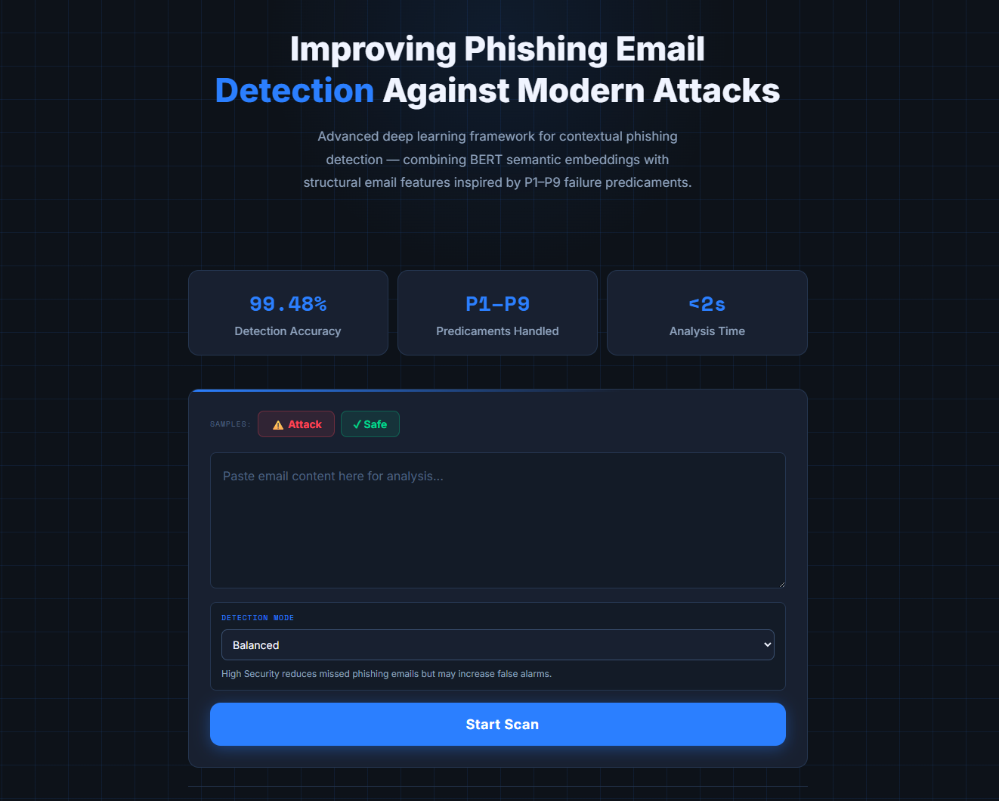
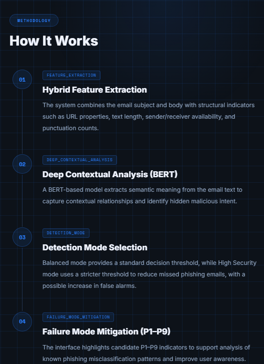

# Improving Phishing Email Detection Against Modern Attacks

**Graduation project — King Saud University**  
Python · NLP · Deep Learning · Cybersecurity · Flask

This repository documents and shares the available **ML training, evaluation, and inference source code** for a group graduation project exploring modern phishing email detection. The focus is on **minimizing false negatives** — phishing emails mistakenly classified as legitimate.

> **Reproducibility notice:** Source code and research summaries are included, but the ~10 GB local project folder, original email datasets, trained BERT/RoBERTa checkpoints, hybrid MLP weights, and scaler artifacts are **not** bundled. The Flask application cannot run until the required checkpoint artifacts are supplied. Reported numbers are historical experiment results, **not independently reproduced** by this repository.

## Project overview

The project compared classical ML baselines against BERT, RoBERTa, and a **Hybrid BERT + Structural Features** model. The hybrid system joins contextual text embeddings with email-level indicators (URL presence and count, text lengths, sender/receiver availability, punctuation counts) and feeds them into a multilayer perceptron.

- **Data:** Nine curated public-source collections, with schema standardization, validation, deduplication and a 70/15/15 internal split.
- **Evaluation:** Internal held-out test, an external blind test, and a separate evaluation of human- vs. AI-generated emails.
- **Prototype:** Python Flask API with `balanced` (0.50) and `high_security` (0.24) classification thresholds.
- **Scope:** Academic prototype, **not a production email-security system**.

## Reported results

| Model | Internal accuracy | False negatives | False positives |
|---|---:|---:|---:|
| SVM | 98.60% | 199 | 222 |
| BERT | 99.48% | 105 | 56 |
| RoBERTa | 99.43% | 138 | **40** |
| **Hybrid BERT + structural features** | **99.48%** | **98** | 63 |

The hybrid model recorded the fewest internal **false negatives** among these reported comparisons, while RoBERTa produced fewer false positives.

**External blind evaluation:** 322,601 emails; 288,535 correctly classified (89.44%), **32,625 false positives** and **1,441 false negatives**. The high number of external false positives is an important generalization limitation.

**AI-generated vs. human-written evaluation:** Of 4,000 emails, 3,351 were correctly classified (83.775%). The human-written subset was 2,000/2,000, while the AI-generated subset was 1,351/2,000 (67.55%), including **522 false positives** and **127 false negatives**. These results should not be interpreted as real-world deployment performance.

For details and data caveats, see [reported results](docs/results.md) and [data/checkpoint requirements](docs/data-and-weights.md).

## Web application showcase

The website interface was designed and implemented by other members of the project team. The research backend and detection code included here were contributed by Hassan.

### Web interface — email submission and scan settings



The team-built web interface allows users to paste an email, choose between **Balanced** and **High Security** detection modes, and request a classification from the Flask backend. The results shown on the interface represent the academic prototype, not production-level assurance.

### How it works — hybrid detection methodology



The methodology panel describes how the detector combines **BERT-based semantic representations** with **email structural indicators** and adjustable decision thresholds. The P1–P9 failure modes motivated the research design; they should not be interpreted as nine independently verified, fully solved challenges.

The interface displayed **99.48% internal evaluation accuracy**, not an external or production benchmark. The displayed `<2s` analysis-time claim has not been independently validated. The appearance of P1–P9 in the UI does not mean all failure modes were fully solved.

## Repository layout

```text
.
├── api.py                       # Flask POST /predict (local prototype)
├── phishing_detector.py         # Hybrid BERT + structural-feature inference
├── hybrid_full.py               # Hybrid model training with saved BERT encoder
├── hybrid_test.py               # Earlier hybrid experiments
├── hybrid_tuning.py             # Internal threshold study
├── TH_tuning.py                 # External threshold study
├── external_test.py             # External blind test pipeline
├── ai_human_external_test.py     # Human/AI external evaluation
├── ai_adaptation_train.py       # Experimental AI adaptation training
├── ai_adaptation_train_v2.py    # Experimental adaptation iteration
├── save_ai_results_summary.py  # Evaluation report generator
├── DL_P.py                      # Local BERT inference example
├── metrics/                     # Sanitized aggregate JSON metric summaries
├── assets/screenshots/          # Team website screenshots (not website code)
├── docs/                        # Reproducibility, results, credits
└── requirements.txt
```

## Local setup (requires missing artifacts)

```bash
python -m venv .venv
# Activate .venv for your platform
pip install -r requirements.txt
python api.py
```

The API will try to load `bert_full_model/` and `hybrid_full_outputs/hybrid_bert_mlp_full.pt` plus `hybrid_full_structural_scaler.pkl`. Those files are intentionally excluded, so **the command will fail without the local trained artifacts**. See [data and weights](docs/data-and-weights.md). This code has passed Python syntax parsing, but has **not** been integration-tested with unavailable checkpoints and datasets.

For training/evaluation, place the required datasets and checkpoints in the expected folders, review paths and hyperparameters, and run the appropriate script. Training can require significant RAM, disk space, and GPU resources. Avoid executing the larger experiments blindly.

## Authors and contributions

This project was developed by a four-member team at King Saud University.

Hassan Hasosah — Team Leader & ML/DL Developer

Led the project and was responsible for developing the machine learning and deep learning models, conducting training experiments, and evaluating model performance.

Other Team Members — Web Development

Designed and developed the website interface used to demonstrate the phishing detection system.

Full team credits and academic supervision details are available in the [project credits](docs/contributions.md).

## Known limitations

- External false positives are substantial and may reflect domain shift or labeling/data-preparation issues; the external source requires further auditing.
- Robustness on AI-generated legitimate emails was limited in the reported experiment.
- Training/evaluation was primarily in English and did not establish multilingual effectiveness.
- The Flask endpoint is a local demonstration without enterprise email integration or production controls.
- Dataset licensing, record-level privacy, and permission to distribute team-created artifacts must be checked before making this project public.

No license is granted by default. Do not redistribute source, datasets, model artifacts, report text, or team UI screenshots without the appropriate rights or permissions.
